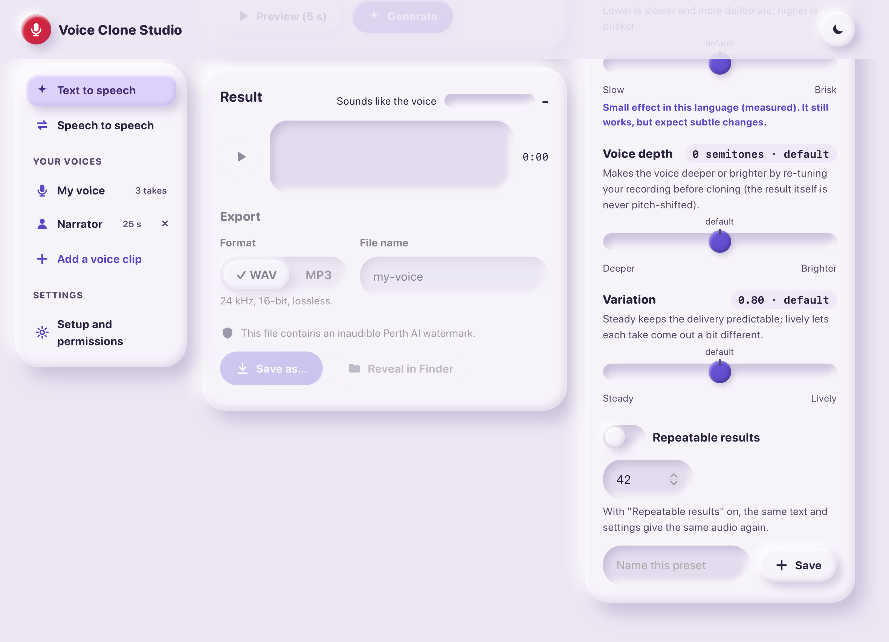

# Voice Clone Studio

A local Mac app that clones your voice. Record a few short samples (or drop in a recording you already have), type some text, and hear it spoken back in your own voice. Tune how it sounds, then save it as WAV or MP3.

Everything runs on your Mac using the Apple Silicon GPU. Nothing is uploaded, and the server listens only on `127.0.0.1`.



## What it is

Voice Clone Studio is a FastAPI backend with a plain HTML/JS front end (no build step, no CDN). It wraps the open-source [Chatterbox](https://github.com/resemble-ai/chatterbox) text-to-speech model (`chatterbox-tts` 0.1.7, MIT, Resemble AI). You can run it in your browser with `./run.sh` or as a native macOS app with its own window and Dock icon.

Every clip carries Chatterbox's inaudible **Perth watermark**, so detection tools can tell the audio is AI-generated. The app leaves the watermark on and says so on the Setup screen.

## Why use it

- **Private:** your voice never leaves your machine. There are no accounts, no cloud API, and no telemetry. The only network access is the one-time model download, and the app asks before starting it.
- **Guided recording:** six short scripts in different tones, with a live level meter, a room-noise check and an automatic quality score for every take. You know when a take is good enough.
- **Or skip recording:** upload any WAV or MP3 of one person talking. The app cuts it into clean clips, drops parts that sound like a different speaker, and takes you straight to the Studio.
- **Controls that really work:** every slider was measured to change the output (see the [table below](#controls)). There are no placebo sliders.
- **Honest audio:** all voice changes happen *before* generation. The generated speech is never pitch-shifted or run through effects afterwards.
- **Choose the length:** speak your whole text, or aim for 5–30 seconds. The app picks whole sentences and never time-stretches the audio.
- **Export:** WAV (24 kHz, 16-bit) or MP3 (128–320 kbps), saved wherever you choose.

## Screenshots

| Setup: choose where the voice comes from | Record: guided scripts with a quality check |
|---|---|
|  |  |

| Voice: pick the takes the clone uses | Studio in dark mode |
|---|---|
|  |  |

*Screenshots come from the automated UI test and use synthetic macOS `say` voices and a simulated microphone.*

## What you need to install

| What | Where it comes from | Approx. size |
|---|---|---|
| A Mac with Apple Silicon (M1 or later), macOS 12+ | | 8 GB RAM minimum, 16 GB+ recommended |
| Python 3.11 | [python.org](https://www.python.org) or `uv python install 3.11` | ~50 MB |
| [uv](https://docs.astral.sh/uv/) (recommended) or pip | `brew install uv` | ~30 MB |
| ffmpeg with libmp3lame (MP3 export and decoding uploaded MP3s) | `brew install ffmpeg` | ~60 MB |
| Python packages from `requirements.txt`: `chatterbox-tts` 0.1.7 (pulls PyTorch 2.6, torchaudio, transformers, librosa, gradio, which is never imported), FastAPI, uvicorn, python-multipart, pywebview 6.2.1 (only for the macOS app) | PyPI | ~1 GB in `.venv` |
| Chatterbox model weights (`ResembleAI/chatterbox`) | huggingface.co | ~3.2 GB in `~/.cache/huggingface` |
| Node.js (only to run the headless-Chrome UI test) | [nodejs.org](https://nodejs.org) | optional |

## Install

```bash
git clone https://github.com/jumppack/voice-clone-studio-app.git
cd voice-clone-studio-app
uv venv --python 3.11 .venv
uv pip install --python .venv/bin/python -r requirements.txt
```

To use pip instead: `python3.11 -m venv .venv && .venv/bin/pip install -r requirements.txt`.

**Model weights:** start the app and open Setup. If the weights are missing, the **Install** button shows the exact download (from huggingface.co, about 3.2 GB) and runs it only after you confirm. You can also download them yourself:

```bash
HF_HUB_DISABLE_TELEMETRY=1 .venv/bin/python -c "from huggingface_hub import hf_hub_download as d; [d('ResembleAI/chatterbox', f) for f in ['ve.safetensors','t3_cfg.safetensors','s3gen.safetensors','tokenizer.json','conds.pt']]"
```

After that, the app runs fully offline (`HF_HUB_OFFLINE=1`).

## Run it

**In the browser:**

```bash
./run.sh
```

This opens `http://127.0.0.1:7861`. Options: `PORT=7900 ./run.sh` changes the port, `NO_BROWSER=1` doesn't open a browser, and `VCS_DATA=/path` uses a different data folder.

**As a macOS app:**

```bash
.venv/bin/python make_app.py                        # builds dist/Voice Clone Studio.app
.venv/bin/python make_app.py --dest /Applications   # also adds a shortcut in /Applications
```

The app is a native window (WKWebView via pywebview) that starts the same backend in-process on a free `127.0.0.1` port. Notes:

- **Microphone:** the first recording triggers macOS's one-time microphone prompt. WebKit microphone access is granted only to the app's own local page.
- **Project folder:** the bundle runs `desktop.py` from this project folder with this folder's `.venv`, so your recordings stay in `data/`. If you move the folder, re-run `make_app.py`.
- **Installed copy:** with `--dest` outside the project, the full app still lives in `dist/`, and the destination gets a small shortcut app that opens it. macOS silently blocks an unsigned app in `/Applications` from reading a project folder on the Desktop, so this keeps it working. Keep `dist/` in place.
- **Unsigned:** the bundle isn't code-signed or notarized. That's fine on the Mac that built it. To share it with other Macs, you'd need a Developer ID signature.
- **Log:** `data/app.log`.
- **Self-test:** `open --env VCS_SELFTEST=1 "dist/Voice Clone Studio.app"` runs in-page checks, writes `data/selftest.json` and quits.

## How to use it

1. **Setup.** Check that everything shows *Ready*, acknowledge the watermark notice, and confirm the voice is yours (or that you have the speaker's permission). Then choose where the voice comes from:
   - **Record my voice** goes on to steps 2 and 3.
   - **Use a recording I have:** choose a WAV or MP3 (M4A, FLAC and OGG also work) and go **straight to the Studio**.
     - You need at least 3 s of speech, and 10 s or more sounds closest. Under 30 MB is suggested, and only the first 10 minutes are used.
     - The file is cut at pauses into up to 6 clips. Parts that sound like a different speaker are left out, and the clearest clip becomes the voice.
2. **Record.** Read six short scripts (explaining, hype, deadpan, question, reaction, story), about 15 s each. Three good takes are enough to continue.
   - Run the 2-second room-noise check first.
   - Press **Space** to start and stop.
   - Each take gets a score with tips about clipping, noise, level, amount of speech or echo.
   - Audio is captured raw at 48 kHz, with echo cancellation, noise suppression and auto gain all off.
3. **Voice.** Choose which take sets the **voice** and which sets the **style**. The best-scoring take is picked by default.
4. **Studio.**
   - Type what your voice should say.
   - Choose **Whole text** or **Set length** (5–30 s).
   - Press **Preview** for a quick built-in passage, or **Generate** for your text.
   - Adjust the controls or pick a preset (*Close to me*, *Narrator*, *Hype*, or one you saved).
   - Use **Save as…** to export. The macOS app opens a native Save dialog, and Chrome/Edge open a Save picker.

Your takes, presets and settings live in `data/`. It's created at runtime and is never committed.

## Controls

All changes happen **before** generation, in the model's conditioning.

| Control | Range | What it changes |
|---|---|---|
| Similarity to my voice | 50–100 % | Blends your speaker embeddings and acoustic prompt with a neutral built-in voice. |
| Expressiveness | 0.25–1.5 | Chatterbox `exaggeration` (emotion intensity). |
| Pacing | 0.2–0.8 | `cfg_weight`: lower is slower and more deliberate. |
| Voice depth | −3…+3 semitones | Re-tunes the **reference recording** before cloning (plain resampling). The output itself is never pitch-shifted. |
| Variation | 0.4–1.2 | `temperature`. "Repeatable results" fixes the seed, which gives bit-identical output. |

### Measured effect (`tests/measure_controls.py`)

These come from the same sentence and reference, averaged over seeds 11/22/33, using a synthetic `say` voice.

| Control (low → high) | Metric | Low | High | Default |
|---|---|---|---|---|
| Similarity 50 % → 100 % | Speaker similarity (cosine) | 0.809 | 0.936 | 0.936 |
| Pacing 0.2 → 0.8 | Words per second | 2.98 | 3.54 | 3.43 |
| Voice depth −3 → +3 st | Median pitch | 96.9 Hz | 142.6 Hz | 110.3 Hz |
| Expressiveness 0.25 → 1.5 | Pitch spread / loudness spread | 3.31 st / 13.5 dB | 3.62 st / 15.0 dB | 3.10 st / 13.1 dB |
| Variation 0.4 → 1.2 | Run-to-run difference (MFCC-DTW) | 39.5 | 47.3 | 42.8 |

For reference, a different speaker scores about 0.61 similarity.

Side effects: depth at ±3 st lowers similarity to about 0.7, and expressiveness 1.5 lowers it to 0.84.

## Project layout

```
├── run.sh            # start the server on 127.0.0.1 and open the browser
├── desktop.py        # native macOS window (pywebview) around the same backend
├── make_app.py       # builds "Voice Clone Studio.app"
├── requirements.txt
├── app/
│   ├── server.py     # FastAPI routes: setup, takes, upload, profile, presets, generate jobs, export
│   ├── engine.py     # Chatterbox wrapper: conditioning, sentence chunking, length targeting, similarity
│   ├── audio.py      # take analysis, trimming, upload decoding/splitting, MP3 via ffmpeg
│   └── scripts.py    # the six recording scripts
├── web/              # index.html, styles.css, app.js, recorder-worklet.js
├── docs/screenshots/
└── tests/
```

## Tests

The test fixtures are synthetic macOS voices and aren't included. Generate them once:

```bash
.venv/bin/python tests/make_fixtures.py
```

Then run the tests:

```bash
HF_HUB_OFFLINE=1 .venv/bin/python tests/cli_smoke.py           # take analysis + one generation
VCS_DATA=$PWD/data_test PORT=7862 NO_BROWSER=1 ./run.sh &       # test server on a separate data folder
VCS_DATA=$PWD/data_test PORT=7862 tests/api_e2e.sh             # takes → previews → exports (ffprobe)
VCS_DATA=$PWD/data_test PORT=7862 .venv/bin/python tests/upload_e2e.py
HF_HUB_OFFLINE=1 .venv/bin/python tests/measure_controls.py    # the control table (~6 min)
.venv/bin/python tests/contrast.py                             # WCAG AA colour contrast, light + dark
node tests/ui_cdp.mjs 7862 studio                              # headless Chrome UI test
```

Always point the API tests at a separate `VCS_DATA` folder, because they replace the takes in it.

## Known limits

- English only.
- One generation at a time. The first preview after start waits for the model to load (about 10–40 s).
- Developed and measured with synthetic voices. How close it sounds to *your* voice is best judged by listening.
- The upload speaker check keeps whoever speaks most in the file, so use a recording that is mostly the target speaker.
- The echo check is a simple heuristic, so treat it as a hint.

## Responsible use

Only clone a voice you own or have explicit permission to use. The app asks you to confirm this before recording or uploading. It keeps Chatterbox's Perth watermark on every output and has no option to remove it.

## Credits

- [Chatterbox](https://github.com/resemble-ai/chatterbox) by Resemble AI (MIT) for the speech model and the Perth watermarker.
- [pywebview](https://pywebview.flowrl.com/) for the native macOS window.

## License

MIT, see [LICENSE](LICENSE). Chatterbox and the other dependencies keep their own licenses.
