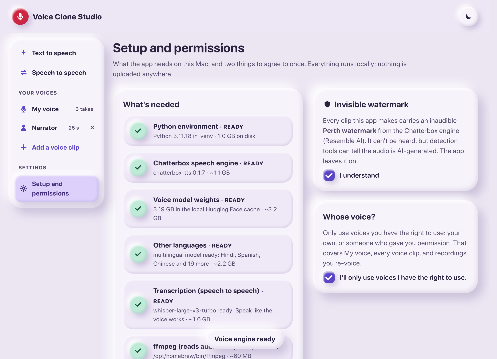
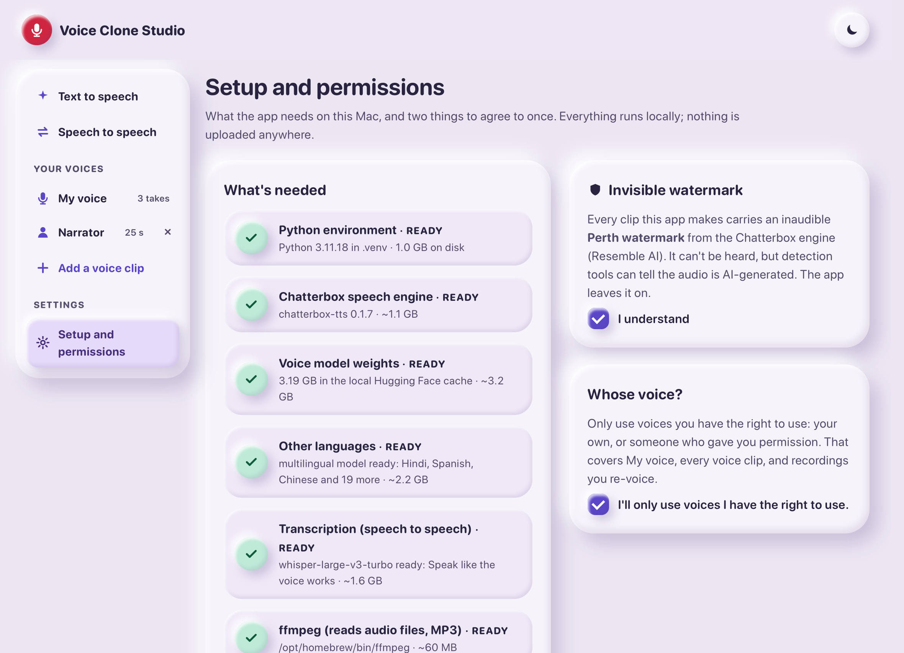
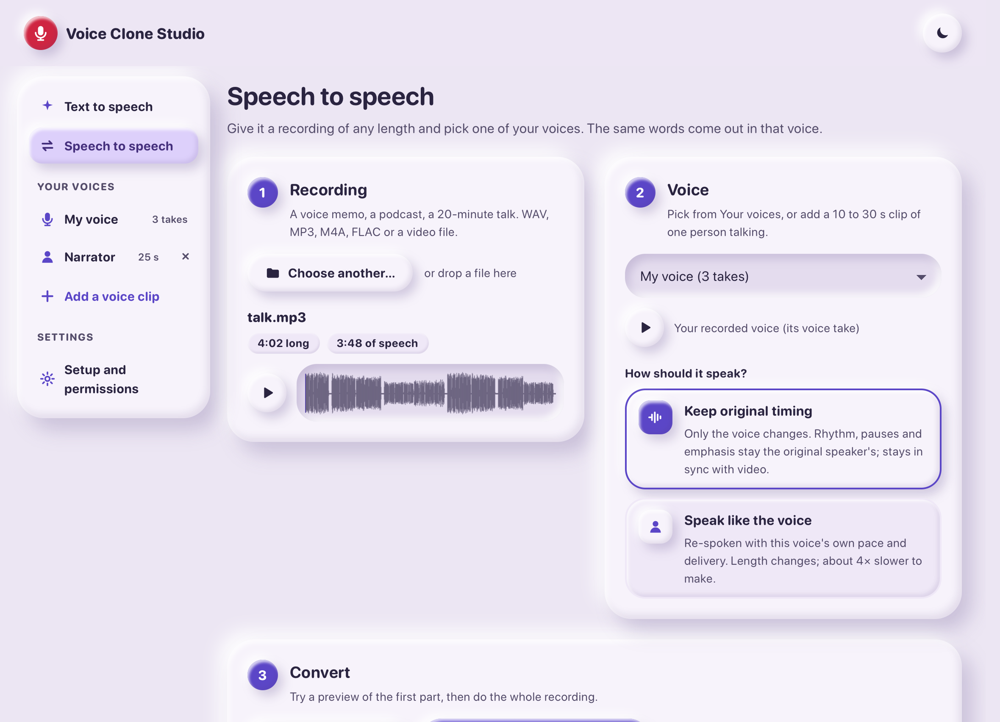
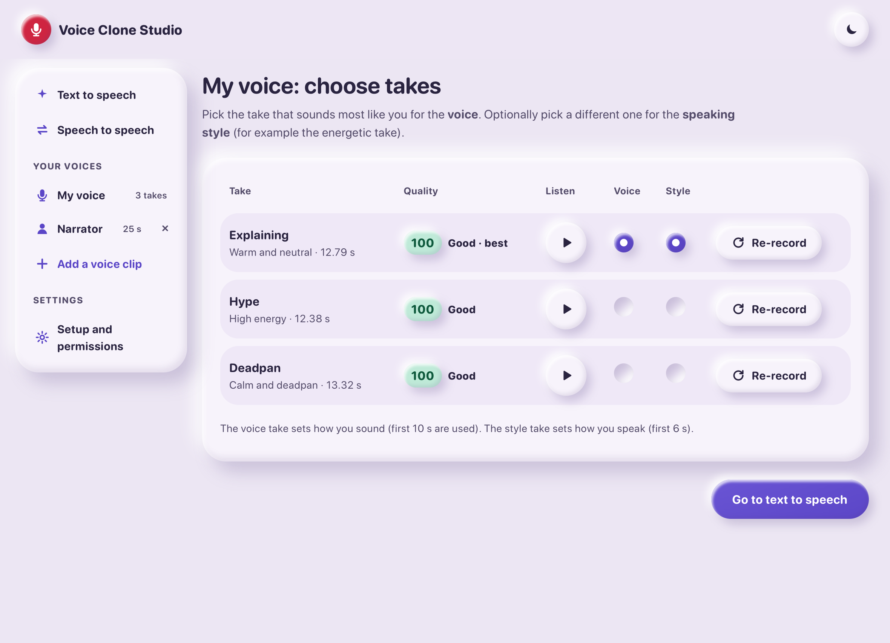
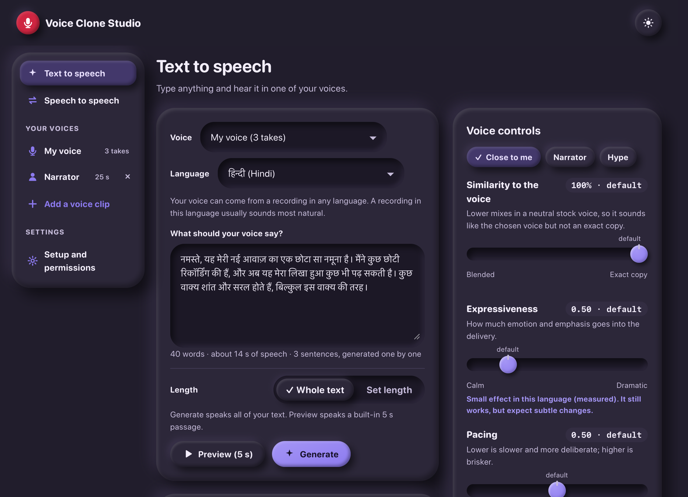
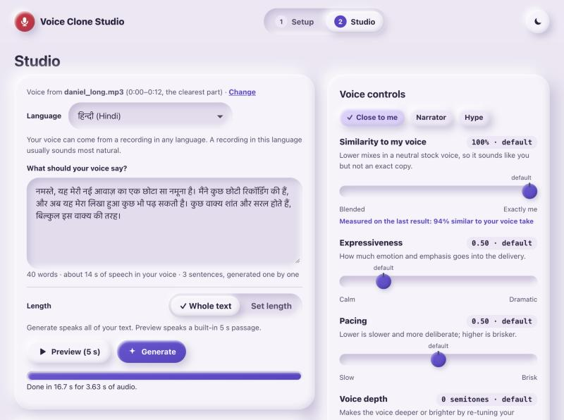

# Voice Clone Studio

A local Mac app for cloned voices, with two modes:

- **Text to speech:** type anything and hear it spoken in one of your voices.
- **Speech to speech:** give it a whole recording (even 20 minutes or more) and it comes out in another voice.

Voices live in one library, **Your voices**. *My voice* is built from a few short recordings of you (or a recording you already have), and you can add any number of 10–30 s clips of other voices you have permission to use. Save results as WAV or MP3.

Everything runs on your Mac using the Apple Silicon GPU. Nothing is uploaded, and the server listens only on `127.0.0.1`.


## What it is

Voice Clone Studio is a FastAPI backend with a plain HTML/JS front end (no build step, no CDN). It wraps the open-source [Chatterbox](https://github.com/resemble-ai/chatterbox) text-to-speech model (`chatterbox-tts` 0.1.7, MIT, Resemble AI). You can run it in your browser with `./run.sh` or as a native macOS app with its own window and Dock icon.

Every clip carries Chatterbox's inaudible **Perth watermark**, so detection tools can tell the audio is AI-generated. The app leaves the watermark on and says so on the Setup screen.

## Why use it

- **Private:** your voice never leaves your machine. There are no accounts, no cloud API, and no telemetry. The only network access is the one-time model download, and the app asks before starting it.
- **Guided recording:** six short scripts in different tones, with a live level meter, a room-noise check and an automatic quality score for every take. You know when a take is good enough.
- **Or skip recording:** upload any WAV or MP3 of one person talking. The app cuts it into clean clips, drops parts that sound like a different speaker, and takes you straight to the Studio.
- **Controls that really work:** every slider was measured to change the output (see the [table below](#controls)). There are no placebo sliders.
- **Honest audio:** all voice changes happen *before* generation. The generated speech is never pitch-shifted or run through effects afterwards.
- **Speech to speech, two ways:** *Keep original timing* changes only the voice, so the result stays in sync with video. *Speak like the voice* re-speaks the words with the chosen voice's own pace and delivery.
- **23 languages:** English plus Hindi, Spanish, French, German, Chinese, Japanese, Arabic and 15 more, in your own voice (optional extra download).
- **Choose the length:** speak your whole text, or aim for 5–30 seconds. The app picks whole sentences and never time-stretches the audio.
- **Export:** WAV (24 kHz, 16-bit) or MP3 (128–320 kbps), saved wherever you choose.

## Screenshots

| Setup and permissions | My voice: record it or use a recording you have |
|---|---|
|  |  |

| Record: guided scripts with a quality check | |
|---|---|
|  | |

| My voice: pick the takes the clone uses | Text to speech in dark mode |
|---|---|
|  |  |

| Speech to speech: a recording, a voice, and how it should speak | Text to speech speaking Hindi |
|---|---|
|  |  |

**Loading screen.** While the speech models load into memory (about 15–40 s after the app opens), an overlay plays a short loop: typed words turning into a waveform (text to speech), then one voice's waveform passing through a swap into another (speech to speech). Videos, rendered frame by frame at 1920×1080, 60 fps: [light](docs/boot_overlay_light.mp4) · [dark](docs/boot_overlay_dark.mp4) (`node tests/record_boot_video.mjs <port> light|dark`).

*Screenshots come from the automated UI test and use synthetic macOS `say` voices and a simulated microphone.*

## What you need to install

| What | Where it comes from | Approx. size |
|---|---|---|
| A Mac with Apple Silicon (M1 or later), macOS 12+ | | 8 GB RAM minimum, 16 GB+ recommended |
| Python 3.11 | [python.org](https://www.python.org) or `uv python install 3.11` | ~50 MB |
| [uv](https://docs.astral.sh/uv/) (recommended) or pip | `brew install uv` | ~30 MB |
| ffmpeg with libmp3lame (MP3 export and decoding uploaded MP3s) | `brew install ffmpeg` | ~60 MB |
| Python packages from `requirements.txt`: `chatterbox-tts` 0.1.7 (pulls PyTorch 2.6, torchaudio, transformers, librosa, gradio, which is never imported), FastAPI, uvicorn, python-multipart, pywebview 6.2.1 (only for the macOS app) | PyPI | ~1 GB in `.venv` |
| Chatterbox model weights (`ResembleAI/chatterbox`) | huggingface.co | ~3.2 GB in `~/.cache/huggingface` |
| *Optional:* multilingual model for the 22 languages besides English (`t3_mtl23ls_v2.safetensors` + tokenizer files, same repo) | huggingface.co | ~2.2 GB |
| *Optional:* local transcription for *Speak like the voice*: `mlx-whisper` 0.4.3 (+ `mlx`, `mlx-metal`, `tiktoken`, `more-itertools`) and the model `mlx-community/whisper-large-v3-turbo` | PyPI (~48 MB) and huggingface.co (1.6 GB) | ~1.7 GB |
| Node.js (only to run the headless-Chrome UI test) | [nodejs.org](https://nodejs.org) | optional |

## Install

```bash
git clone https://github.com/jumppack/voice-clone-studio-app.git
cd voice-clone-studio-app
uv venv --python 3.11 .venv
uv pip install --python .venv/bin/python -r requirements.txt
```

To use pip instead: `python3.11 -m venv .venv && .venv/bin/pip install -r requirements.txt`.

**Model weights:** start the app and open Setup. If the weights are missing, the **Install** button shows the exact download (from huggingface.co, about 3.2 GB) and runs it only after you confirm. You can also download them yourself:

```bash
HF_HUB_DISABLE_TELEMETRY=1 .venv/bin/python -c "from huggingface_hub import hf_hub_download as d; [d('ResembleAI/chatterbox', f) for f in ['ve.safetensors','t3_cfg.safetensors','s3gen.safetensors','tokenizer.json','conds.pt']]"
```

**Other languages (optional):** the Setup screen's **Other languages** item downloads the multilingual model after you confirm, or run:

```bash
HF_HUB_DISABLE_TELEMETRY=1 .venv/bin/python -c "from huggingface_hub import hf_hub_download as d; [d('ResembleAI/chatterbox', f) for f in ['t3_mtl23ls_v2.safetensors','grapheme_mtl_merged_expanded_v1.json','Cangjie5_TC.json']]"
```

**Speak like the voice (optional):** install the transcription package, then fetch its model (Setup → **Transcription** does the download after you confirm):

```bash
uv pip install --python .venv/bin/python mlx-whisper==0.4.3
HF_HUB_DISABLE_TELEMETRY=1 .venv/bin/python -c "from huggingface_hub import hf_hub_download as d; [d('mlx-community/whisper-large-v3-turbo', f) for f in ['config.json','weights.safetensors']]"
```

After that, the app runs fully offline (`HF_HUB_OFFLINE=1`).

## Run it

**In the browser:**

```bash
./run.sh
```

This opens `http://127.0.0.1:7861`. Options: `PORT=7900 ./run.sh` changes the port, `NO_BROWSER=1` doesn't open a browser, and `VCS_DATA=/path` uses a different data folder.

**As a macOS app:**

```bash
.venv/bin/python make_app.py                        # builds dist/Voice Clone Studio.app
.venv/bin/python make_app.py --dest /Applications   # also adds a shortcut in /Applications
```

The app is a native window (WKWebView via pywebview) that starts the same backend in-process on a free `127.0.0.1` port. Notes:

- **Microphone:** the first recording triggers macOS's one-time microphone prompt. WebKit microphone access is granted only to the app's own local page.
- **Project folder:** the bundle runs `desktop.py` from this project folder with this folder's `.venv`, so your recordings stay in `data/`. If you move the folder, re-run `make_app.py`.
- **Installed copy:** with `--dest` outside the project, the full app still lives in `dist/`, and the destination gets a small shortcut app that opens it. macOS silently blocks an unsigned app in `/Applications` from reading a project folder on the Desktop, so this keeps it working. Keep `dist/` in place.
- **Unsigned:** the bundle isn't code-signed or notarized. That's fine on the Mac that built it. To share it with other Macs, you'd need a Developer ID signature.
- **Log:** `data/app.log`.
- **Self-test:** `open --env VCS_SELFTEST=1 "dist/Voice Clone Studio.app"` runs in-page checks, writes `data/selftest.json` and quits.

## How to use it

The sidebar has **Text to speech**, **Speech to speech**, **Your voices** and **Setup and permissions**.

1. **Setup and permissions.** Check that everything shows *Ready*, acknowledge the watermark notice, and confirm you'll only use voices you have the right to use. That's all this page holds.
2. **Your voices.**
   - **My voice** (optional; you can use voice clips only). Choose where it comes from:
     - **Record my voice** leads to *Record takes* and *Choose takes*.
     - **Use a recording I have:** choose a WAV or MP3 (M4A, FLAC and OGG also work). At least 3 s of speech, 10 s or more sounds closest; only the first 10 minutes are used. The file is cut at pauses into up to 6 clips, parts that sound like a different speaker are left out, and the clearest clip becomes the voice.
   - **My voice → Record takes:** six short scripts (explaining, hype, deadpan, question, reaction, story), about 15 s each; three good takes are enough. Run the 2-second room check first, press **Space** to start and stop, and each take gets a score with tips. Audio is captured raw at 48 kHz.
   - **My voice → Choose takes:** which take sets the *voice* and which the *style*.
   - **Add a voice clip:** 10–30 s of one person talking, no music. Only the first 30 s of speech are kept. Click a clip to hear it; × removes it.
3. **Text to speech.** Pick a **Voice** and a **Language**, type the text, choose **Whole text** or **Set length** (5–30 s), then **Preview** or **Generate**. Adjust the controls or pick a preset, and **Save as…** to export.
4. **Speech to speech.** Drop in a recording, pick a voice, and choose how it should speak:
   - **Keep original timing:** only the voice changes. The rhythm, pauses and emphasis stay the original speaker's, and the result has exactly the original length.
   - **Speak like the voice:** the recording is transcribed on this Mac and spoken again with the voice's own pace and delivery. The length changes, and it is about 4× slower to make.

   **Preview first part** converts the first ~20 s; **Convert whole recording** does all of it, with progress and Cancel. The result player's **New voice / Original** switch compares the two at the same moment.

Your takes, voices, presets and settings live in `data/`. It's created at runtime and is never committed.

## Controls

All changes happen **before** generation, in the model's conditioning.

| Control | Range | What it changes |
|---|---|---|
| Similarity to the voice | 50–100 % | Blends the voice's speaker embeddings and acoustic prompt with a neutral built-in voice. |
| Expressiveness | 0.25–1.5 | Chatterbox `exaggeration` (emotion intensity). |
| Pacing | 0.2–0.8 | `cfg_weight`: lower is slower and more deliberate. |
| Voice depth | −3…+3 semitones | Re-tunes the **reference recording** before cloning (plain resampling). The output itself is never pitch-shifted. |
| Variation | 0.4–1.2 | `temperature`. "Repeatable results" fixes the seed, which gives bit-identical output. |

### Measured effect (`tests/measure_controls.py`)

These come from the same sentence and reference, averaged over seeds 11/22/33, using a synthetic `say` voice.

| Control (low → high) | Metric | Low | High | Default |
|---|---|---|---|---|
| Similarity 50 % → 100 % | Speaker similarity (cosine) | 0.809 | 0.936 | 0.936 |
| Pacing 0.2 → 0.8 | Words per second | 2.98 | 3.54 | 3.43 |
| Voice depth −3 → +3 st | Median pitch | 96.9 Hz | 142.6 Hz | 110.3 Hz |
| Expressiveness 0.25 → 1.5 | Pitch spread / loudness spread | 3.31 st / 13.5 dB | 3.62 st / 15.0 dB | 3.10 st / 13.1 dB |
| Variation 0.4 → 1.2 | Run-to-run difference (MFCC-DTW) | 39.5 | 47.3 | 42.8 |

For reference, a different speaker scores about 0.61 similarity.

Side effects: depth at ±3 st lowers similarity to about 0.7, and expressiveness 1.5 lowers it to 0.84.

### Other languages (multilingual model)

Measured the same way (`tests/measure_controls.py hi`, `... es cfg_weight,exaggeration`):

| Control (low → high) | Metric | Hindi | Spanish |
|---|---|---|---|
| Similarity 50 % → 100 % | Speaker similarity | 0.762 → 0.912 | |
| Voice depth −3 → +3 st | Median pitch | 98 → 136 Hz | |
| Variation 0.4 → 1.2 | Run-to-run difference | 36.9 → 50.0 | |
| Pacing 0.2 → 0.8 | Words per second | 2.78 → 2.90 (small) | 2.38 → 2.69 |
| Expressiveness 0.25 → 1.5 | Pitch spread / median pitch | 3.66 → 3.10 st / 117 → 123 Hz (small) | 2.84 → 4.16 st / 112 → 119 Hz |

In Hindi, Pacing and Expressiveness change the output only a little, and the Studio says so next to those sliders when Hindi is selected. A fixed seed is bit-identical in every language.

A 10 s preview in each of the 23 languages (`tests/languages_test.py all`, synthetic English reference voice) came out between 8.4 and 12.1 s, with similarity 0.91–0.95 and no degenerate chunks. On a language's first run, its starting pace guess can be off by a second or two; the estimate is re-learned after each generation.

## Speech to speech

*Keep original timing* uses Chatterbox's speech-to-speech path. The S3 tokenizer turns the original speech into speech tokens, and S3Gen renders them in the chosen voice. Those tokens carry what is said **and how**: rhythm, pauses and intonation. So the voice changes, but the delivery stays the original speaker's. The voice change happens at the conditioning stage, with no pitch shifting or vocoder effects afterwards.

How a long file is handled:

- It is cut into pieces of about 20 s (8–30 s), only at pauses. Pauses of 2 s or more stay silent and aren't sent to the model.
- Each piece goes back at its exact original time, so the output has the original length to the sample. Each piece keeps the original's loudness (a plain gain).

*Speak like the voice* generates the speech again instead:

1. The recording is transcribed locally (`whisper-large-v3-turbo` via `mlx-whisper`, on the Apple GPU).
2. Each sentence is spoken by the text-to-speech engine, with the voice clip as both the voice and the speaking-style prompt.
3. The voice's speaking pace is measured, and the *pacing* setting (`cfg_weight`) is steered sentence by sentence toward it.
4. Between sentences it pauses like the voice does. Long pauses in the original (1.5 s or more) are kept, so paragraphs survive.

Measured (`tests/changer_test.py`, `tests/restyle_test.py`, synthetic voices, Apple Silicon GPU):

| | Original vs voice | Keep original timing | Speak like the voice |
|---|---|---|---|
| Voice match (VoiceEncoder similarity) | 0.67–0.68 | 0.90 (20 min, lowest part 0.82) | 0.96–0.97 |
| Length | | identical, long pauses kept | changes with the voice's pace |
| Speaking pace, fast voice (21.8 chars/s; original 17.8) | | 17.8 (original's) | **22.2** |
| Speaking pace, slow voice (15.3 chars/s; original 17.8) | | 17.8 (original's) | 17.3 (pacing setting at its minimum) |
| Time for a 20-minute recording | | 7–13 min (10–25 s clip) | about 40 min |

- **Reference length:** a longer clip sounds closer in *Keep original timing* (5 s → 0.885, 10 s → 0.896, 20 s → 0.910, 30 s → 0.922) but makes each piece slower. The app uses up to 30 s of speech.
- **Voice match measures the sound of the voice, not its rhythm.** That's why *Keep original timing* can score 0.90 and still sound like the original speaker's delivery.
- **No knobs, on purpose:** flow-matching steps (4, 10, 20) made no measurable difference, so there is no quality slider.

Limits: in *Keep original timing*, music or noise under the voice comes out garbled, because the model turns everything it hears into speech. *Speak like the voice* follows a faster voice fully but a slower one only partly, and its words come from the transcript, so check names and unusual words. Overlapping speakers all become the one voice. Output is mono, 24 kHz.

## Project layout

```
├── run.sh            # start the server on 127.0.0.1 and open the browser
├── desktop.py        # native macOS window (pywebview) around the same backend
├── make_app.py       # builds "Voice Clone Studio.app"
├── requirements.txt
├── app/
│   ├── server.py     # FastAPI routes: setup, takes, upload, profile, presets, generate jobs, export
│   ├── engine.py     # Chatterbox wrapper: conditioning, sentence chunking, length targeting, similarity
│   ├── audio.py      # take analysis, trimming, upload decoding/splitting, MP3 via ffmpeg
│   ├── languages.py  # the 23 languages, their preview passages and starting pace
│   ├── voices.py     # Your voices: My voice + voice clips (/api/voices)
│   ├── sts.py        # Speech to speech routes: recording upload, convert jobs, export (/api/sts)
│   ├── converter.py  # Keep original timing: piece planning + voice conversion
│   ├── restyle.py    # Speak like the voice: transcription + re-speaking with pace steering
│   └── scripts.py    # the six recording scripts
├── web/              # index.html, styles.css, app.js, sts.js (voices + speech to speech), recorder-worklet.js
├── docs/screenshots/
└── tests/
```

## Tests

The test fixtures are synthetic macOS voices and aren't included. Generate them once:

```bash
.venv/bin/python tests/make_fixtures.py
```

Then run the tests:

```bash
HF_HUB_OFFLINE=1 .venv/bin/python tests/cli_smoke.py           # take analysis + one generation
HF_HUB_OFFLINE=1 .venv/bin/python tests/languages_test.py all  # a 10 s preview in each of the 23 languages
HF_HUB_OFFLINE=1 .venv/bin/python tests/changer_test.py [minutes] # Keep original timing: length, silence, voice match
HF_HUB_OFFLINE=1 .venv/bin/python tests/restyle_test.py         # Speak like the voice: pace vs a slow and a fast voice
VCS_DATA=$PWD/data_test PORT=7862 NO_BROWSER=1 ./run.sh &       # test server on a separate data folder
VCS_DATA=$PWD/data_test PORT=7862 tests/api_e2e.sh             # takes → previews → exports (ffprobe)
VCS_DATA=$PWD/data_test PORT=7862 .venv/bin/python tests/upload_e2e.py
HF_HUB_OFFLINE=1 .venv/bin/python tests/measure_controls.py    # the control table (~6 min)
.venv/bin/python tests/contrast.py                             # WCAG AA colour contrast, light + dark
node tests/ui_cdp.mjs 7862 studio                              # headless Chrome UI test
```

Always point the API tests at a separate `VCS_DATA` folder, because they replace the takes in it.

## Known limits

- **Languages:** the recording scripts are English, but you can upload a recording in any language. Hebrew is spoken without vowel marks and Russian without stress marks, because their optional helper packages aren't installed, which may affect pronunciation. Pronunciation hasn't been checked by a native speaker or a speech recognizer; only length, similarity and stability were measured.
- One generation at a time. The first preview after start waits for the model to load (about 10–40 s).
- Developed and measured with synthetic voices. How close it sounds to *your* voice is best judged by listening.
- The upload speaker check keeps whoever speaks most in the file, so use a recording that is mostly the target speaker.
- The echo check is a simple heuristic, so treat it as a hint.

## Responsible use

Only clone a voice you own or have explicit permission to use. The app asks you to confirm this before recording or uploading. It keeps Chatterbox's Perth watermark on every output and has no option to remove it.

## Credits

- [Chatterbox](https://github.com/resemble-ai/chatterbox) by Resemble AI (MIT) for the speech model and the Perth watermarker.
- [pywebview](https://pywebview.flowrl.com/) for the native macOS window.

## License

MIT, see [LICENSE](LICENSE). Chatterbox and the other dependencies keep their own licenses.
